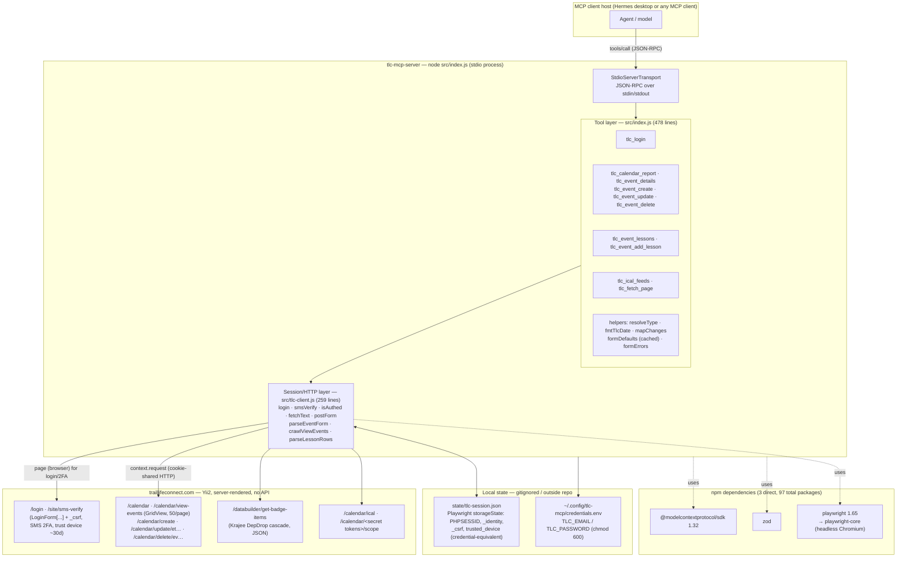
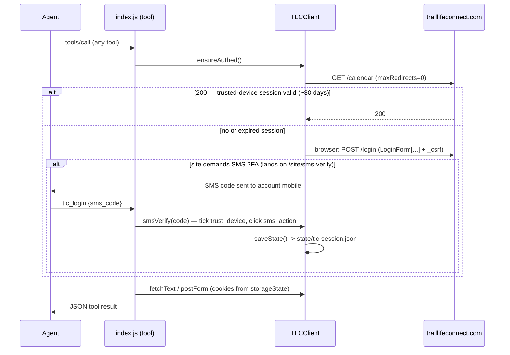

# tlc-mcp-server — Architecture

How this project is put together: an MCP tool layer over a session-based Yii2 website that
has no API. See [USAGE.md](USAGE.md) for how to operate it; this document explains the
components, the dependency graph, and the data flows.

## 1. System overview

## 2. Layer responsibilities

### Tool layer — `src/index.js`
The MCP surface. Owns **what the agent may say**, not how HTTP works.

- **Registration:** `@modelcontextprotocol/sdk` `McpServer` + `zod` input schemas; one
  `StdioServerTransport` at the bottom of the file (`server.connect(transport)`).
- **10 registered tools** (line anchors): `tlc_login` (:143), `tlc_calendar_report` (:179),
  `tlc_event_details` (:218), `tlc_event_create` (:246), `tlc_event_update` (:282),
  `tlc_event_delete` (:311), `tlc_event_lessons` (:342), `tlc_event_add_lesson` (:364),
  `tlc_ical_feeds` (:446), `tlc_fetch_page` (:462).
- **Friendly→site translation:** `changeParams` (shared zod schema for create/update),
  `mapChanges` (friendly names → `Event[...]` field names), `resolveType` (label/token →
  `event_type_id`, rejects ambiguous matches), `fmtTlcDate` (ISO-ish → the site's
  `MM-DD-YYYY hh:mm AM` range string), `formDefaults` (caches the live create form's default
  values + event-type options once per process).
- **Safety semantics:** update = load-patch-write (posts the whole current form back with
  only given fields overridden); delete + add_lesson both **verify by re-reading** the grid
  instead of trusting the response page text (Yii landing pages can carry misleading flashes).
- **Session bootstrap:** `ensureSession()` before every tool except `tlc_login`; credentials
  loaded from env or `~/.config/tlc-mcp/credentials.env`.

### Session/HTTP layer — `src/tlc-client.js`
The single `TLCClient` class; everything site-facing.

| Method | Role |
|---|---|
| `start/saveState/stop` | Launch headless Chromium; attach or create `storageState` (`state/tlc-session.json`). All post-login traffic uses `context.request` (APIRequestContext) — shares browser cookies **without page rendering**. |
| `login(email,password)` | Drives the real `/login` form in the browser (`LoginForm[email|password]`), fails on still-on-`/login`, saves state. |
| `smsVerify(code)` | Fills `/site/sms-verify` (`#sms-verify-code`), forces `trust_device=1` (the Krajee `#w0` checkbox), clicks `sms_action`, saves the trusted session. |
| `isAuthed` | Liveness probe: `GET /calendar` with `maxRedirects:0`; 302 ⇒ session dead. |
| `ensureAuthed` | `isAuthed` → else re-login with credentials (throws a clear error if credentials absent). |
| `fetchText(path)` | Authenticated GET; detects `UNAUTHENTICATED` by 302 or the login-page marker. |
| `postForm(path, fields, {csrfSource})` | Yii form POST. **CSRF is re-extracted per POST** from `meta[name=csrf-token]` or the hidden `_csrf` input of `csrfSource` (tokens rotate). |
| `parseEventForm(html)` | Extracts the `<form id="event-form">` (~87 `Event[...]` inputs/selects/textareas) with current values — the basis of details-read and partial-update. |
| `crawlViewEvents` | `/calendar/view-events` grid crawler: `data-key="ev…"`, edit links `et…`, cell text by `data-col-seq`, pagination to the max `?page=N`, cap 40 pages. |
| `parseLessonRows(html)` | Parses the `troop_lessons_grid` sub-grid on an event page (`data-key="les…"` rows). |

### Site facts the code encodes (why it looks like this)
- **Two/three id schemes:** `ev…` (event), `et…` (edit ref), `les…` (lesson row) — tools accept
  either id where practical and convert via crawl.
- **Krajee widgets:** GridView pagination (50/page), checkbox-x hidden inputs (why `rememberMe`/
  trust checkboxes are set via `el.value='1'`), DepDrop cascade (`POST depdrop_parents[0]=<badge id>`;
  GET-style `depdrop_parents[]=` returns an empty payload).
- **Level ids hardcoded** in `tlc_event_add_lesson`: `Woodlands Trail=wt`,
  `Navigators=j8e296a067a3`, `Adventurers=x1ff1de77400` (site-stable ids, not account-specific).

## 3. Session & 2FA flow

## 4. npm dependency map

Direct dependencies (`package.json`): **3**. Lockfile resolves **97 packages** (~93 installed).

| Package | Version | Used by | What it does here |
|---|---|---|---|
| `@modelcontextprotocol/sdk` | ^1.32.2 | `src/index.js` | `McpServer`, `registerTool`, `StdioServerTransport` — the MCP protocol server side. Brings the notable transitives below. |
| `zod` | (peer via SDK) | `src/index.js` | Declarative input schemas for all 10 tools; the SDK converts them to JSON Schema for `tools/list`. |
| `playwright` | ^1.65.1 | `src/tlc-client.js` | Headless Chromium: browser-driven login/2FA, then `context.request` for cookie-shared HTTP. Requires the matching Chromium build (`npx playwright install chromium`). |

Notable transitives (from the lockfile), grouped:

| Group | Packages | Why they're there |
|---|---|---|
| MCP SDK HTTP/streaming stack | `express`, `router`, `accepts`, `body-parser`, `send`, `serve-static`, `hono`, `cors`, `eventsource`, `eventsource-parser` | The SDK ships optional HTTP/SSE transports; only **stdio** is used here, but their deps install regardless. |
| MCP SDK auth/schema stack | `jose` (JWE/JWT), `pkce-challenge`, `ajv`, `ajv-formats`, `json-schema-traverse`, `json-schema-typed`, `zod-to-json-schema` | SDK-side OAuth-ish tooling and schema conversion (zod → JSON Schema). |
| Playwright | `playwright-core` | The actual browser driver (launcher, CDP/protocol, request API). |
| Support utilities | `debug`, `ms`, `mime-types`, `iconv-lite`, `qs`, `cookie`, `path-to-regexp`, etc. | Ordinary plumbing of the above. |

There are **no database, ORM, or HTTP-client libraries** — persistence is one
`storageState` JSON file, and HTTP is Playwright's own request context.

## 5. Repository inventory

| Path | Role | Shipped? |
|---|---|---|
| `src/index.js` | MCP server: tool registration, schemas, domain helpers. | yes |
| `src/tlc-client.js` | `TLCClient`: session, CSRF, form/grid parsers. The reusable library. | yes |
| `package.json` / `package-lock.json` | 3 direct deps; stdio entry `src/index.js` (`bin: tlc-mcp-server`). | yes |
| `test-report.js` | Read-path verification over real MCP stdio (live data). | yes |
| `test-write.js` | Create→report→details→update→delete regression loop with a labeled test event. | yes |
| `recon.js` `recon2.js` `recon3.js` `recon4.js` | Discovery scripts from the original site-mapping phase: session check, login→2FA dump, 2FA completion (`argv` code), route dumps. Historical; kept for re-mapping after site changes. | yes |
| `assign-lessons.js` | One-shot batch of the Year-2 branch plan (8 hardcoded `et…` refs). Leaf consumer of `tlc-client.js` — nothing imports it; superseded by `tlc_event_add_lesson` for ad-hoc use. | yes |
| `README.md` | Quickstart + site notes (route/id/form cheat-sheet). Tool table stale vs the 10 tools (see USAGE.md). | yes |
| `IDEA.md` | Original one-line project intent. | yes |
| `state/tlc-session.json` | Live session cookies. **gitignored — credential-equivalent.** | no |
| `out/` | Recon dumps: full page HTML, CSV grid export, `.ics` feeds containing real troop data + **secret feed URLs**. **gitignored.** | no |
| `node_modules/`, `*.log` | Build/runtime. **gitignored.** | no |

## 6. Security boundaries

- **Secrets live outside the repo:** credentials file at `~/.config/tlc-mcp/credentials.env`;
  session state in `state/`; site data dumps in `out/` — all three excluded by `.gitignore`.
  A fresh `git init && git add -A` therefore stages nothing secret *as long as the
  `.gitignore` is committed and nothing is force-added*.
- **iCal feed URLs are bearer secrets** (`/icalendar/<token>/<token>/scope`) — they exist only
  in runtime output and gitignored `out/` files, never in source.
- **No credentials or personal data are hardcoded in `src/`.** The only account-specific data
  in tracked code is the `assign-lessons.js` plan table of live `et…` event refs (object ids,
  not secrets — only meaningful with an authenticated session).
- **Login etiquette:** the client throws after a failed login attempt rather than retrying
  (site lockout risk); 2FA codes are accepted only via tool argument / argv, never stored.
